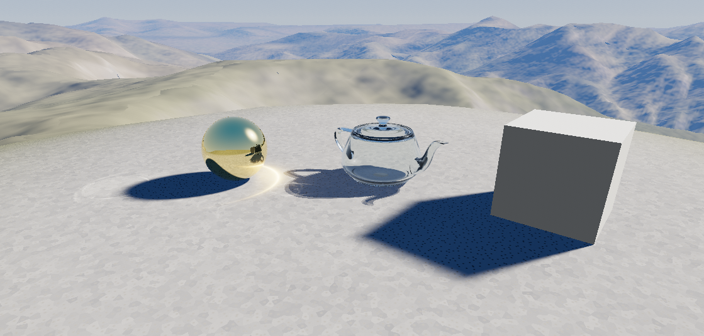

# Deterministic Ray Tracing

## What is it?
Normal ray tracing, as is seen in games and other software alike, uses a [stochastic](https://en.wikipedia.org/wiki/Stochastic_process) method of sampling, leading to inherent noise that necessitates either very high sample counts, which is extremely performance-intensive,
with the alternative of using denoisers, which come with their own downsides and often do not fully solve the issue. However, there is another way, being deterministic ray tracing. With perhaps the most notable example being Whitted-style ray tracing, this is when rays,
rather than being cast randomly, are cast knowing their exact path beforehand. This means that, with the downsides of a lack of soft shadows, caustics, and unfocused reflections, one can trace a scene with no noise at a surprising rate if properly optimized.

## Why?
I have done many experiments with ray tracing in the past, and I have always been infuriated with the issues of noise. I have long sought to rid myself of this great pestilence, and I saw something in deterministic RT that could solve all my issues at a small cost.
I turned out to be correct, and I am now quite happy with what I have produced. I will likely continue working on this project, in order to create a full game.

## How does it work?
It works just like Whitted-style raytracing does, but with the added benefits of soft shadows and caustics. This bridges all the aforementioned gaps, creating a perfectly noiseless render that is impressively accurate and blazing fast. I included a (BVH)[https://en.wikipedia.org/wiki/Bounding_volume_hierarchy] in order to not descend into the pit of despair that is low FPS. LoD supplements this as well.
For the terrain, I utilized JAXA's AW3D30 to pull a mountainous chunk of terrain from around the location of Tuva in Russia, as it gives some moderate mountains along with some steppe good for testing long-distance graphics.

## Caustics
One of the main downsides that comes with the usage of deterministic ray tracing is the lack of caustics. While normally caustics provide an extremely beautiful aspect to glass, in this renderer they would ordinarily be completely absent. However, we have a not-so-simple answer to this issue:

$$\Large E(\mathbf{x}_2) = \sum_{u \in \mathbf{x}_2^{-1}} \frac{E_{\text{inc}}(\mathbf{x}_1) \cdot \mathcal{T}_F \cdot \cos\theta_i}{\mathcal{J}(u)}$$

In short:

$$\Large E(\mathbf{x}_2) = \sum \frac{\text{Light entering}}{\text{How much it was concentrated}}$$

It determines how much light entered the glass and from where, and then calculates how much it was concentrated, thus producing a caustic map that can be displayed. Caustics, hooray!

I cannot, myself, pretend to fully understand this formula, however. See the AI section for more information.
However, it does create great on-the-fly caustics.

## Use of Artificial Intelligence
This project was heavily supported by my use of Gemini's latest models through Google's AI Studio. As I am not a programmer by trade, I simply designed the application and the ways it should be used, performed research, and generally produced a blueprint on how it should be built.
Gemini assisted me by getting in the dirt and producing the actual code that would be run in order to create such a beautiful image. All of the things that I instructed it to do were thoroughly researched ahead of time (if I hadn't done this, I would have been completely unable to explain the function provided above)
